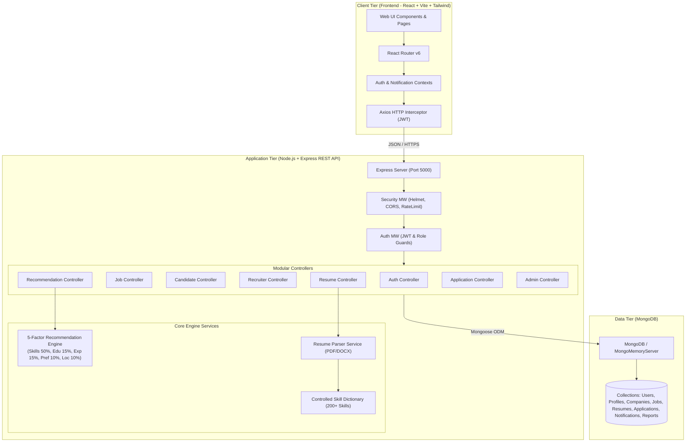
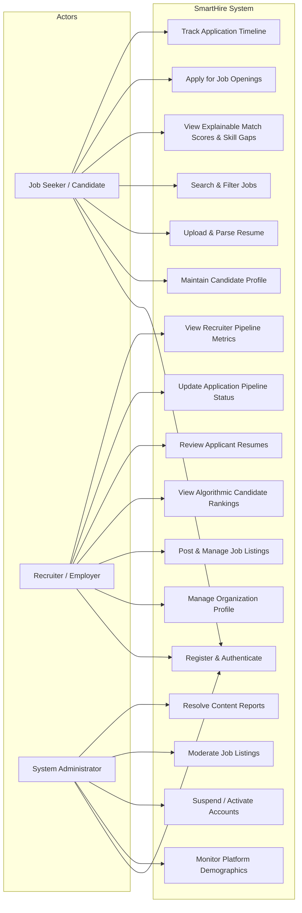
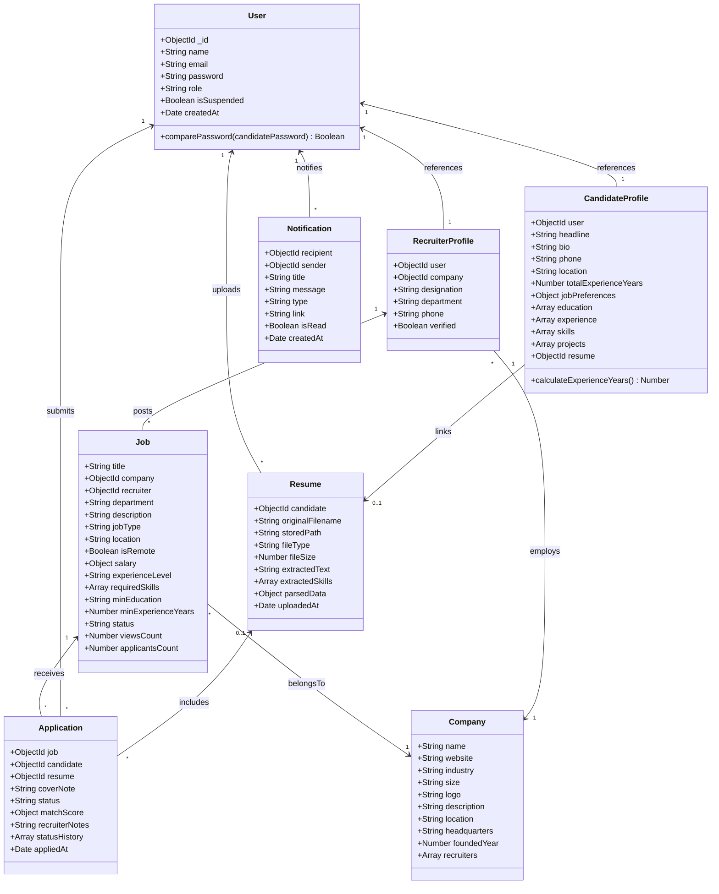
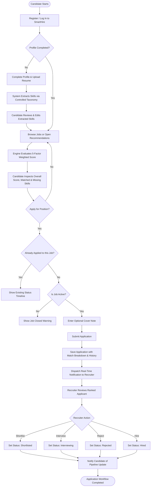
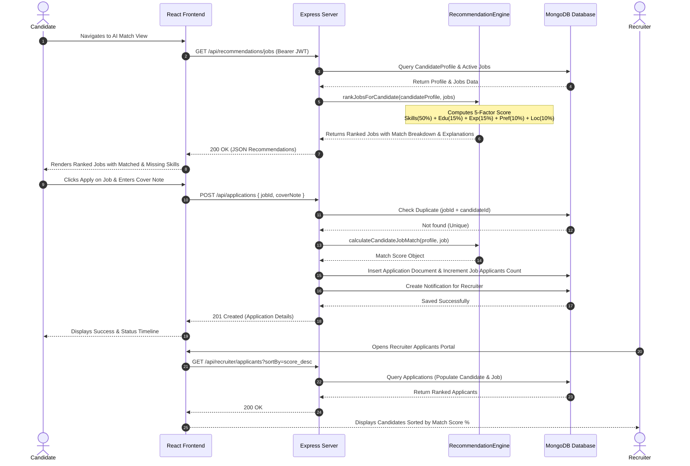
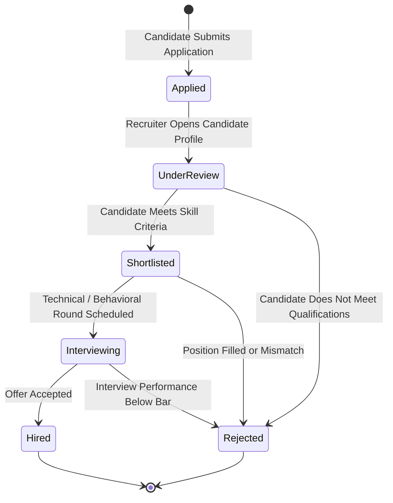
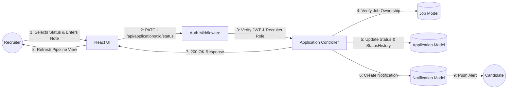
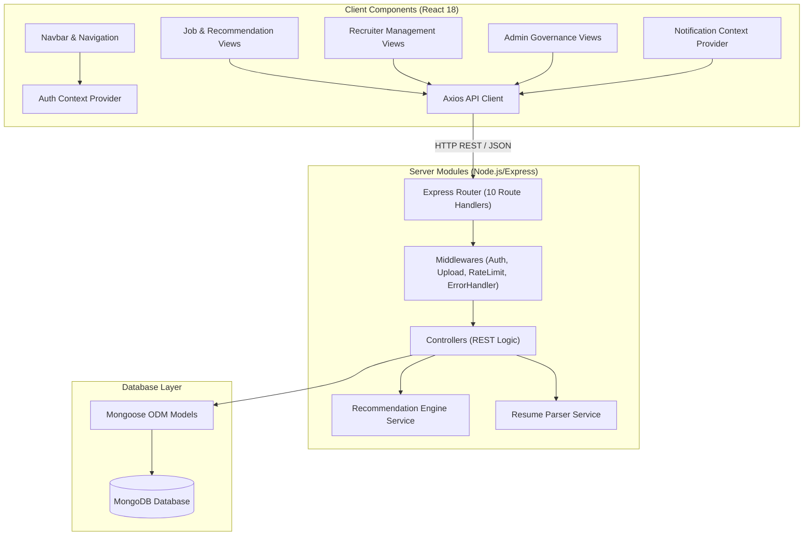
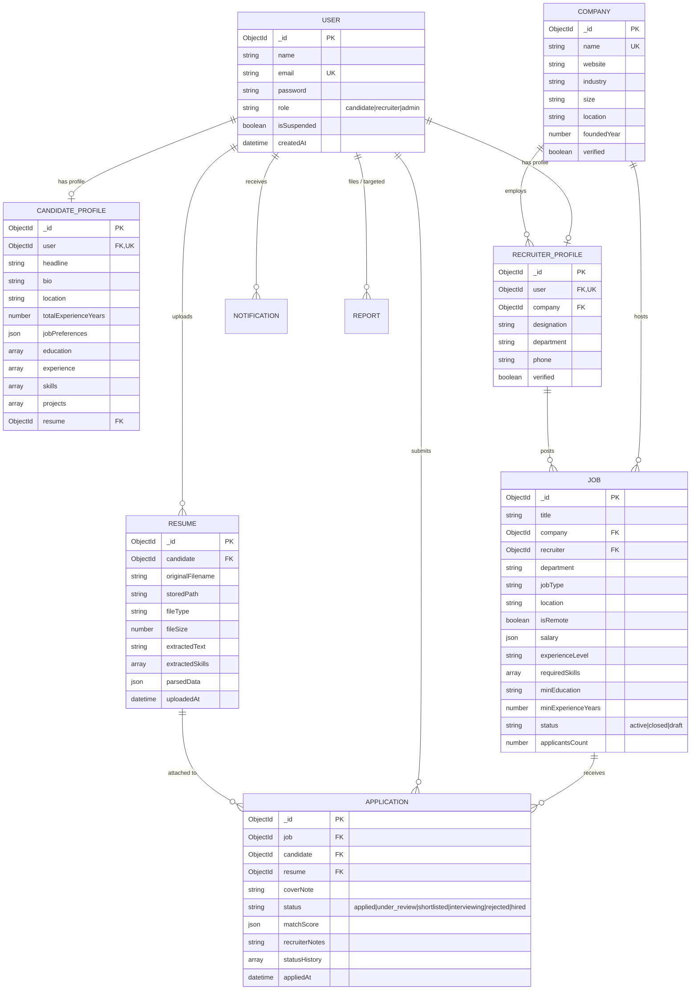

# SmartHire — Complete UML & System Architecture Diagrams

This document contains editable **Mermaid** diagrams accurately reflecting the implemented SmartHire platform.

---

## 1. System Architecture Diagram

---

## 2. Use Case Diagram

---

## 3. Class Diagram

---

## 4. Activity Diagram: Candidate Job Application Workflow

---

## 5. Sequence Diagram: Algorithmic Recommendation & Application

---

## 6. State Chart Diagram: Application Lifecycle

---

## 7. Communication Diagram: Recruiter Updating Applicant Status

---

## 8. Component Diagram

---

## 9. Entity-Relationship (ER) Diagram

